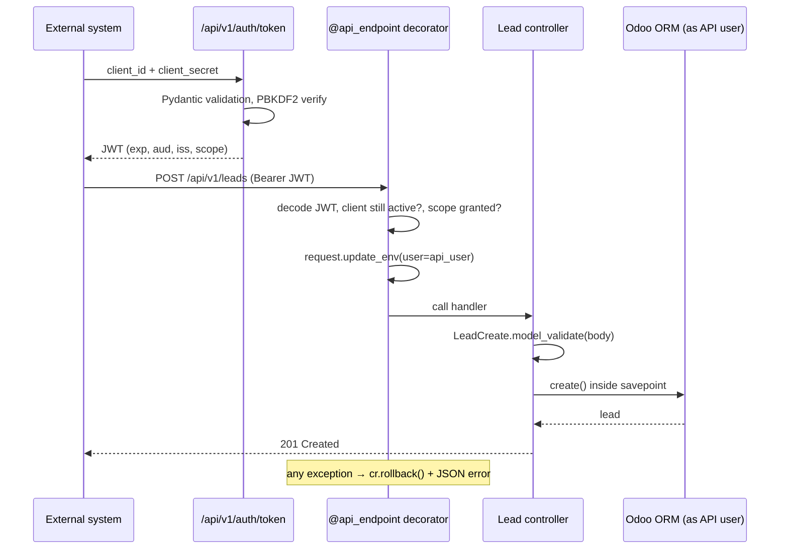

# Odoo Secure REST API — JWT + Pydantic v2


A REST API layer for Odoo built the way I'd ship one to production. It exposes
CRM leads to external systems and focuses on the parts that usually go wrong:
authentication, input validation, access rights and **transaction safety**.

> This is a clean-room showcase module. It contains no client or employer code.

---

## Highlights

| Concern | How it's handled |
|---|---|
| **Authentication** | OAuth2-style *client credentials* → short-lived **JWT** (HS256, `aud`/`iss`/`exp` enforced, algorithm pinned) |
| **Secrets** | Client secrets stored as **PBKDF2-SHA256** hashes, shown once and never written to the DB in plain text, not even in the wizard table. Signing key generated per database on install, never hardcoded |
| **Authorization** | Per-client **scopes** (`leads:read`, `leads:write`), re-checked on every call. Archiving a client revokes its live tokens immediately |
| **Least privilege** | Requests run as the client's **technical user** via `request.update_env()`, never `sudo()`, so normal access rights and record rules apply |
| **Validation** | **Pydantic v2** schemas with `extra="forbid"`, typed fields, a cross-field rule (email *or* phone) and query-param validation |
| **Transaction safety** | Any error **rolls back** the request. Batch import uses one **`savepoint()` per item** for partial persistence |
| **Idempotency** | `external_ref` and a unique index make retries safe, including two concurrent requests racing for the same reference |
| **Safe errors** | One JSON error format. Validation errors never echo submitted values back. 500s are logged server-side, never leaked |
| **Timing safety** | Unknown client and wrong secret return the same response in roughly the same time (no client-ID probing) |

## Request flow



## Endpoints

| Method | Path | Scope | Description |
|---|---|---|---|
| `POST` | `/api/v1/auth/token` | — | Exchange client credentials for a bearer token |
| `GET` | `/api/v1/leads?limit=&offset=` | `leads:read` | Paginated list (`limit` ≤ 200) |
| `GET` | `/api/v1/leads/<id>` | `leads:read` | Read one lead |
| `POST` | `/api/v1/leads` | `leads:write` | Create a lead (idempotent on `external_ref`) |
| `POST` | `/api/v1/leads/batch` | `leads:write` | Up to 100 leads, partial success → `207 Multi-Status` |

### Example

```bash
# 1. Get a token
TOKEN=$(curl -s -X POST http://localhost:8069/api/v1/auth/token \
  -H "Content-Type: application/json" \
  -d '{"client_id": "<id>", "client_secret": "<secret>"}' | jq -r .access_token)

# 2. Create a lead
curl -s -X POST http://localhost:8069/api/v1/leads \
  -H "Authorization: Bearer $TOKEN" -H "Content-Type: application/json" \
  -d '{"external_ref": "ORD-1001", "name": "Merchant signup", "email": "owner@shop.sa", "expected_revenue": 2500}'
```

Batch response with one invalid item:

```json
{
  "results": [
    {"index": 0, "status": "created", "id": 41},
    {"index": 1, "status": "invalid", "errors": [{"loc": [], "msg": "Value error, either email or phone is required", "type": "value_error"}]},
    {"index": 2, "status": "existing", "id": 17}
  ],
  "summary": {"total": 3, "succeeded": 2, "failed": 1}
}
```

Error format, the same everywhere:

```json
{"error": {"code": "insufficient_scope", "message": "Scope 'leads:write' is required."}}
```

## Setup

1. Install the Python dependencies: `pip install -r requirements.txt`
2. Add this repository to your `addons_path` and install **`rest_api_jwt`**.
3. Go to **Settings → Technical → REST API Clients**, create a client, pick a technical *Run As* user, then click **Generate Secret**.

## Project layout

```
rest_api_jwt/
├── controllers/
│   ├── base.py        # @api_endpoint: auth, scopes, env switch, rollback, error mapping
│   ├── auth.py        # token endpoint
│   └── leads.py       # CRUD + savepoint-based batch
├── schemas/           # Pydantic v2 request/response models
├── services/tokens.py # JWT issue/verify, no HTTP dependencies
├── models/            # rest.api.client (hashed secrets, scopes) + crm.lead external_ref
├── wizard/            # show-once secret dialog (secret travels only in context)
└── tests/             # HttpCase end-to-end + schema unit tests
```

## Tests

14 tests cover the security and transaction behaviour end to end: expired and
forged tokens, revocation, scope changes after issuance, no-echo validation
errors, idempotency, partial batch persistence and running as the API user
rather than superuser.

```bash
odoo-bin -d test_db --addons-path=odoo/addons,. -i rest_api_jwt \
  --test-tags=/rest_api_jwt --stop-after-init
```

CI runs `ruff` and the full Odoo test suite against PostgreSQL on every push.

## Possible extensions

- Rate limiting per client (e.g. a Redis token bucket or reverse-proxy limits)
- Asymmetric signing (RS256) with key rotation and a JWKS endpoint
- OpenAPI schema generated from the Pydantic models

---

**Author:** [Khaled Bassiouni Salah](https://www.linkedin.com/in/k-salah/), Senior Odoo Engineer
